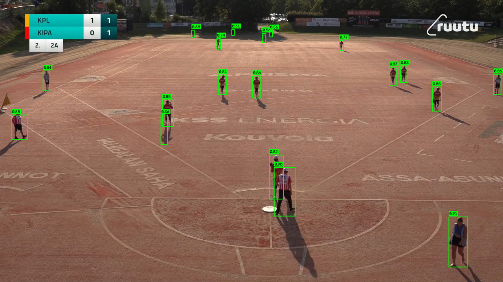
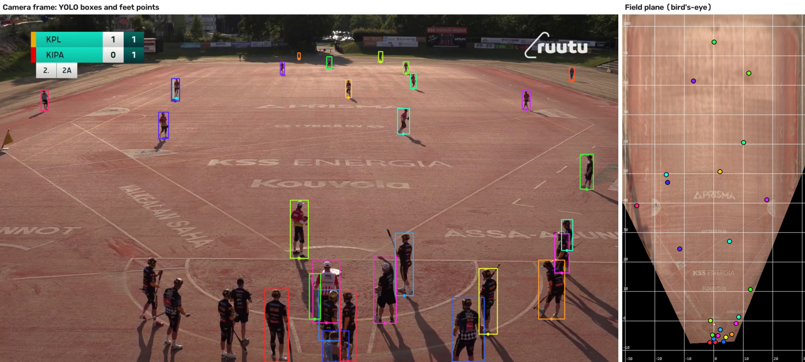
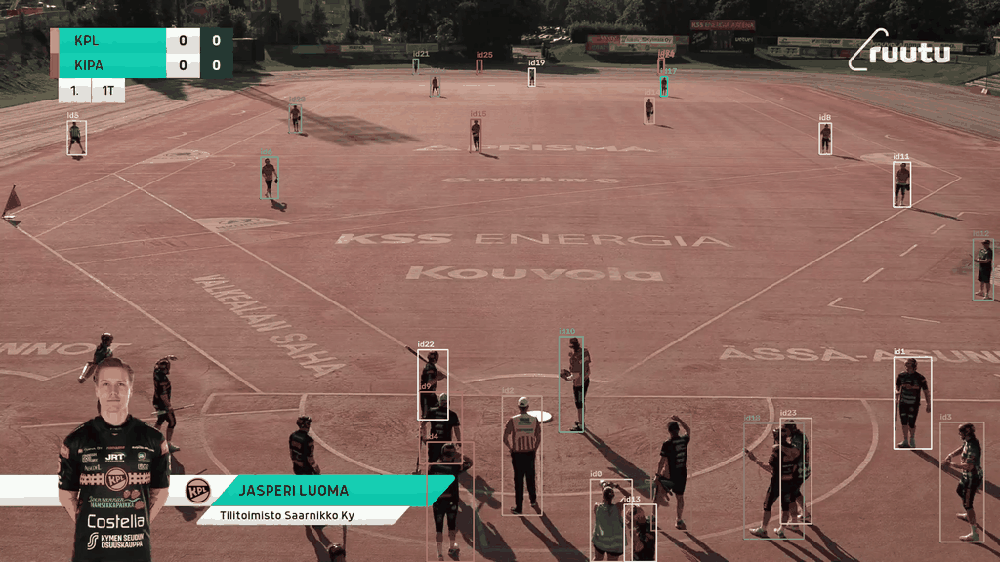

# Finnish Baseball Vision

Player detection, tracking and team classification from single-camera match video of Finnish baseball (*pesäpallo*).



*Tiled YOLOv8 detections with confidence scores on a broadcast frame, after the field-mask, size and shadow filters.*

## Why this is hard

The camera covers the whole field, so far-field players are only about 35 px tall in a 1920×1080 frame. Standard YOLO inference resizes the frame to about 640 px, which shrinks those players to about 12 px, below reliable detection size. Shadows, sideline graphics and spectators add false positives.

## Approach

- **Tiled detection.** Each frame is split into overlapping 640 px tiles. YOLOv8 (COCO `person` class) runs on every tile in GPU batches, and detections are merged with cross-tile NMS and a containment check, so small players keep a detectable relative size. Boxes are then filtered with a field mask, a perspective-aware size filter and a shadow check.
- **Classical baseline for comparison.** A rolling median background model with HSV-based shadow suppression and a perspective-aware size filter. In a side-by-side comparison on match footage it produced far more false positives (shadow slivers, graphic overlays) than YOLO, so YOLO is used downstream.
- **Tracking.** Detections are linked across frames with ByteTrack (via the `trackers` package). An alternative, simpler matcher estimates the dominant motion with RANSAC and assigns boxes with the Hungarian algorithm. The labelling tool uses a greedy centroid tracker.
- **Team and role classification.** Torso colour is sampled from foreground pixels only and represented in a chroma space (saturation·cos(hue), saturation·sin(hue), value), which keeps near-black and near-white kits distinguishable. Each track is classified once, from the median of its samples, by the nearest role prototype. A labelling tool collects labelled colour samples track by track; prototypes (or an optional k-NN classifier) are built from them.
- **Field calibration and bird's-eye mapping.** Field markings were picked by hand in `notebooks/field_analysis.ipynb` and paired with their field coordinates, giving a planar homography from image pixels to the field plane. `src/field_mapping.py` maps each player's feet point (bottom centre of the box) through it, which gives field (x, y) positions. The size filter does not use the calibration yet; it still uses a two-point linear placeholder.
- **Time series output.** Per-frame detections are saved as Parquet tables for downstream movement analysis.



*Detections from one frame mapped to field coordinates (grid every 10 field units, home base at y = 0). Players cut off by the bottom edge of the frame have no visible feet, so they map slightly too close to the camera.*



## Repository structure

| Path | Purpose |
| --- | --- |
| `src/yolo_detector.py` | Tiled YOLOv8 detector with cross-tile NMS |
| `src/player_detection_pipeline.py` | Classical background-subtraction baseline |
| `src/object_tracking.py` | Tracking (ByteTrack and RANSAC + Hungarian) and trail animations |
| `src/team_classifier.py` | Jersey colour features, prototype and k-NN role classifiers |
| `src/labeling_tool.py` | Interactive tool for labelling players track by track |
| `src/video_bbox_extraction.py` | Full-video detection to Parquet time series |
| `src/field_mapping.py` | Maps boxes to field coordinates and renders the bird's-eye view |
| `src/visualize_predictions.py` | Annotated overlays for visual checks |
| `src/config.py`, `config.yaml` | Config loader, and all parameters in one place |
| `data/` | Empty-field reference image, field mask, calibration points, labelled colour samples |
| `notebooks/` | Field calibration (planar homography) and early detection experiments |
| `out/` | Example Parquet time series from a test clip |
| `experiments/` | Unrelated side experiment: ball flight simulation |
| `assets/` | Images for this README |

## How to run

From the repository root:

```bash
pip install -r requirements.txt
python src/video_bbox_extraction.py --video path/to/match.mp4 --frame-stride 8
```

Match footage is not included in the repository. Set its path in `config.yaml` or pass `--video`. The empty-field reference image and field mask in `data/` (`paths.empty_field` and `paths.mask` in `config.yaml`) match this camera view; other footage needs its own. The YOLOv8 weights are downloaded by `ultralytics` on first use. A CUDA GPU is recommended; on CPU, set `yolo.device: "cpu"`.

## Context

Personal hobby project, 2026. Developed with the help of AI coding assistants.

## License

MIT
